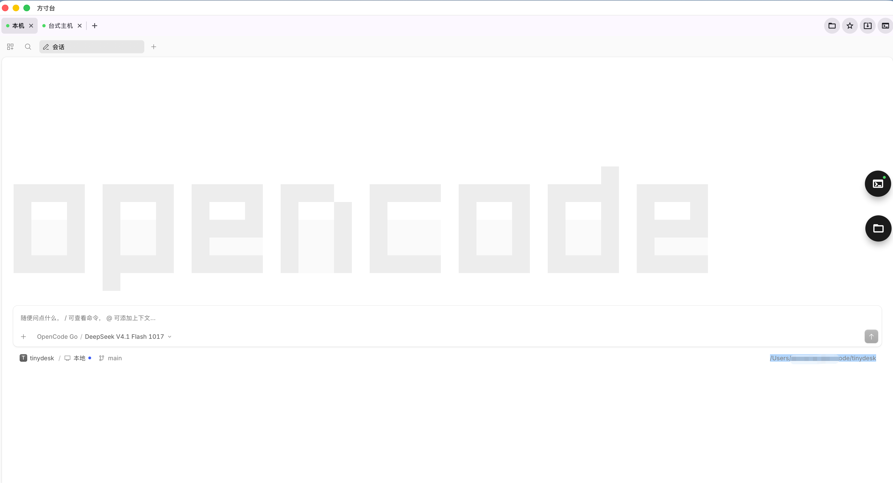
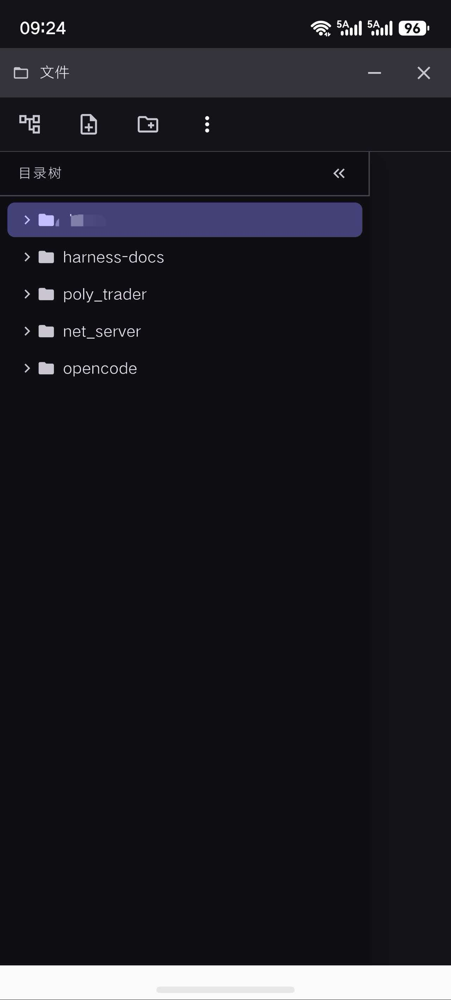
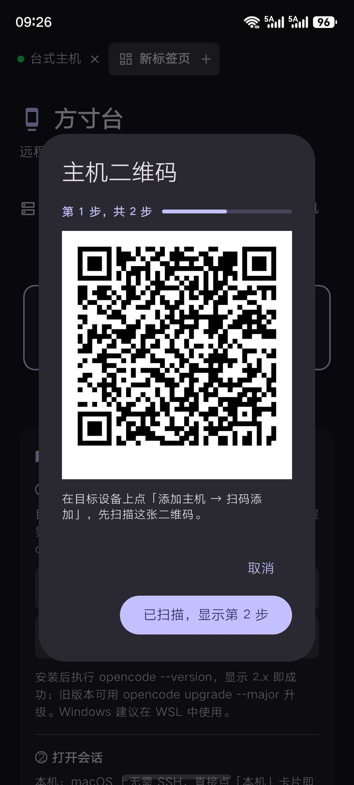
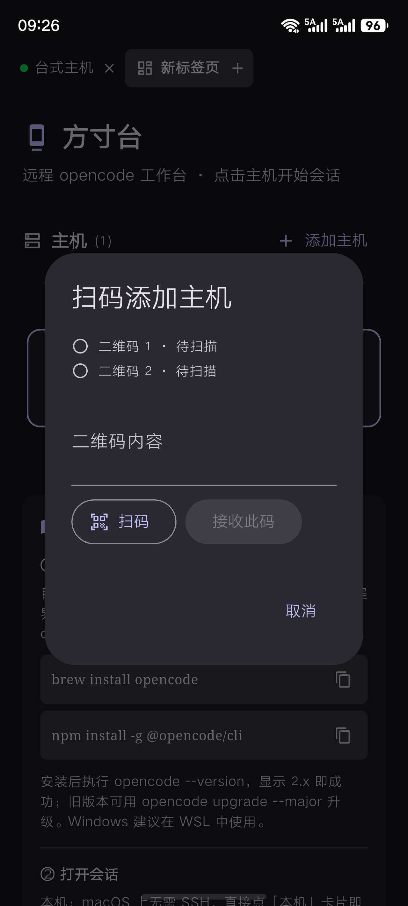

# TinyDesk

English | [简体中文](README.zh-CN.md)

**Keep [opencode](https://opencode.ai/) within reach — on your phone and your computer.**

[opencode](https://opencode.ai/) is a terminal-based AI coding agent that runs on your computer or server. Once it starts a task, it is stuck to that machine: jobs often run for minutes at a time, and you can't stay glued to the screen — step away for coffee, check in on your commute, peek at what it changed from bed, or approve a permission request. Switching to another device means setting everything up again.

TinyDesk exists to fix that: the app establishes an SSH tunnel automatically and opens the full opencode UI, while adding a terminal, file browsing, and cross-device favorites and reading progress. It turns opencode into a workbench you carry with you.

<p align="center">
  
  &nbsp;&nbsp;
  
</p>

No changes are needed on the server — reuse your existing `sshd` and opencode. No public ports, no agent to install.

## Features

- **Multi-host sessions**: keep multiple SSH connections alive at once, switch with the tab bar; reopening the app restores your previous sessions.
- **Embedded opencode Web UI**: reach `opencode serve` on the server through local port forwarding — no public ports exposed.
- **This Machine host** (macOS): use the opencode already installed locally; no SSH, no host configuration.
- **Terminal**: remote hosts get an SSH shell; the local host uses the system login shell (`$SHELL -l`). Multiple sessions in parallel, with PTY size sync on window resize.
- **Floating file browser**: a draggable floating ball + fullscreen window you can summon anytime; state is preserved when minimized; multiple project roots side by side, lazy directory tree, create/delete, favorites.
- **Document viewing & editing**: Markdown (dual read/edit mode, local images referenced by the document load automatically), code and text (CodeMirror 6), PDF, Word, Excel/CSV, images.
- **Cross-device host transfer via QR codes**: encode a host (including its private key) into **two QR codes shown one after another** — one random key code, one encrypted content code. They are shown on separate screens, never visible at the same time, so a single screenshot cannot reconstruct the data; content expires in 15 minutes. The target device imports automatically after scanning both (camera on macOS/iOS/Android, system scanner on HarmonyOS; desktop can also paste).
- **Favorites & reading progress**: favorites are grouped per host; favorites and Markdown/PDF reading positions are written to `.tinydesk/users/<SSH username>/` in the project — shared across devices for the same user, isolated between different server accounts.
- **Auto sync**: open documents and expanded directories are checked every 5 seconds for server-side changes and updated automatically (never overwrites unsaved edits — it only reports a conflict).
- **opencode upgrade**: read the current and latest version on the host, upgrade in one tap and restart the service.
- **Security**: private keys and passphrases are stored in the system secure storage; host fingerprints are confirmed on first connect and blocked on change.
- **Languages**: English and Simplified Chinese, switchable in Settings (follow system / Chinese / English).
- **Settings** (top-right of the host list): dark mode, font scaling, background keep-alive, auto-hide keyboard on entering a session, clear local data.

## Platform support

| Platform | Status | Notes |
|---|---|---|
| macOS | ✅ | Full features, including the This Machine host and local terminal |
| iOS | ✅ | Full features; no This Machine host |
| Android | ✅ | Full features; no This Machine host |
| HarmonyOS NEXT | ✅ | Full features; no This Machine host |
| Linux / Windows | 🚧 Planned | Needs a desktop WebView solution, not implemented yet |

## How it works

```
┌──────────────────────────── Device ────────────────────────┐
│  Flutter UI                                                │
│    ├─ Host list / session tabs                             │
│    ├─ WebView (opencode Web UI)                            │
│    ├─ Floating terminal (SSH shell / local PTY)            │
│    └─ Floating file browser (SFTP / local files)           │
│                                                            │
│  dartssh2 ── local forward 127.0.0.1:<local> ──┐           │
└────────────────────────────────────────────────┼───────────┘
                                                 │ SSH :22
┌────────────────────────────────────────────────▼───────────┐
│  Server                                                    │
│    sshd                                                    │
│    opencode serve 127.0.0.1:49374                          │
└────────────────────────────────────────────────────────────┘
```

- Each host connection allocates a free local port on the device and forwards it to the opencode service on the server.
- Files and the terminal reuse the same SSH connection (SFTP + shell channel).
- The desktop "This Machine" host starts/connects to opencode directly on the machine via the loopback interface — no SSH.

## Host prerequisites

The server only needs the existing `sshd` and opencode v2 — no agent, no public ports.

```bash
# Check the opencode version (v2 required)
opencode --version

# The service listens on 127.0.0.1:49374 by default;
# if you changed the config, restore loopback and the default port
opencode service set hostname 127.0.0.1
opencode service set port 49374

opencode service start
opencode service status   # should print http://127.0.0.1:49374
```

On the app side you need:

- SSH login to that host with an OpenSSH-format private key (passphrase-protected keys are supported; PuTTY `.ppk` is not, and password login is not supported yet)
- Confirm the host fingerprint on first connect
- The remote port defaults to `49374`; a local port is allocated automatically and can be changed in the host form

## Install & build

Requires Flutter 3.47 or newer stable.

```bash
git clone https://github.com/ushuaia/tinydesk.git tinydesk
cd tinydesk
flutter pub get
```

### macOS

```bash
flutter build macos --release
open build/macos/Build/Products/Release/TinyDesk.app
```

Dependencies are managed with CocoaPods; 1.17 or newer is recommended (older versions cannot resolve the current SPM configuration).

### iOS

```bash
flutter build ios --release
```

The project does not pin a development team — pick your own Team in Xcode on first build.

### Android

```bash
flutter build apk --release
```

Without a release keystore the debug signing is used; configure your own signing before publishing.

### HarmonyOS NEXT

Prerequisites: install DevEco Studio (with the HarmonyOS SDK and the `ohpm`/`hdc` toolchain; sign in with a Huawei developer account on first launch) and the Flutter-OH fork ([openharmony-sig/flutter_flutter](https://gitcode.com/openharmony-sig/flutter_flutter), see the notes in `scripts/env-ohos.sh`); enable developer mode and USB debugging on the phone.

```bash
# 1. Prepare signing config (once)
cp ohos/build-profile.example.json5 ohos/build-profile.json5
# Open ohos/ in DevEco Studio and generate auto signing in
# Project Structure → Signing Configs

# 2. Build
source scripts/env-ohos.sh
export JAVA_TOOL_OPTIONS="-Djdk.util.zip.disableZip64ExtraFieldValidation=true"
flutter build hap --release

# 3. Install
hdc install -r build/ohos/hap/entry-default-signed.hap
```

Troubleshooting: if the SDK is not recognized, run `flutter config --ohos-sdk <sdk path>`; when `ohpm`/`hdc` are not on PATH, add DevEco Studio's `Contents/tools/ohpm/bin` and `Contents/sdk/default/openharmony/toolchains` to PATH; if the phone won't connect, check USB debugging and try `hdc kill` first. For the rest, refer to the Huawei developer docs and the Flutter-OHOS community docs.

## Usage

1. **Add a host**: host list → Add; fill in the address, port and username, paste an OpenSSH private key (optional passphrase).
2. **Connect**: tap the host, wait for the tunnel and service probe, and the workspace opens.

   <p align="center">
     
     &nbsp;&nbsp;&nbsp;
     
   </p>
3. **Workspace toolbar**: files, favorites, opencode upgrade, terminal.
4. **File browser**: the floating ball is draggable; tap to expand, state survives minimizing; "More → Refresh" re-reads files from the server.

   <p align="center">
     
     &nbsp;&nbsp;&nbsp;
     
   </p>
5. **This Machine** (macOS): created automatically, tap to use; the terminal runs the system login shell.
6. **Settings**: top-right of the host list; "Clear data" removes hosts, keys, sessions, favorites and reading progress on this device, but keeps device preferences like the theme.
7. **Transfer a host across devices**: on the device that has the host, tap the host menu "Show host QR code"; on the new device use "Add host → Scan to add" and scan the two codes one after another to migrate the host (including its key); on desktop you can also copy/paste.

   <p align="center">
     
     &nbsp;&nbsp;&nbsp;
     
   </p>

## Where is my data?

| Data | Location |
|---|---|
| Host list, session state, settings | On the device (app-private storage) |
| Private keys and passphrases | System secure storage (Keychain / Keystore / Asset Store) |
| Favorites, reading progress | `.tinydesk/users/<SSH username>/` in the project (on the server); shared across devices for the same user, isolated between accounts |
| opencode session cookie | System WebView cookie store |

## Security model

- Direct SSH to the host — no relay servers, no telemetry, no cloud sync.
- Host fingerprints are recorded after first confirmation; a changed fingerprint blocks the connection and requires confirmation.
- Private keys and passphrases live in system secure storage: Keychain on macOS/iOS, Keystore-backed encrypted storage on Android, Asset Store on HarmonyOS.
- Plaintext keys left in SharedPreferences by older versions are migrated automatically on startup and the plaintext is deleted.
- Private keys, passphrases and session cookies are never written to logs or temp files.

## Development

```bash
flutter test      # unit + widget tests
flutter analyze   # static analysis
```

End-to-end connectivity check (no app needed):

```bash
OC_TEST_HOST=your-host.example.com \
OC_TEST_PORT=22 \
OC_TEST_USER=user \
OC_TEST_KEY=$HOME/.ssh/id_ed25519 \
dart run tool/integration_check.dart
```

### Project layout

```
lib/
├─ core/            session management, connection state machine
├─ data/            host repository, secure storage, local sessions, favorites & sync
├─ ssh/             SSH connection, port forwarding, tunnel sessions
├─ opencode/        service probe, pairing, opencode CLI resolution
├─ features/
│  ├─ hosts/        host list & forms
│  ├─ connect/      connection progress
│  ├─ workspace/    WebView workspace & session tabs
│  ├─ terminal/     floating terminal
│  ├─ documents/    floating file browser & document views
│  └─ settings/     settings
└─ platform/        platform channels (file picker, window, input interception, …)
third_party/        webview_flutter HarmonyOS adapter, xterm fork
docs/               design docs & build notes
tool/               dev helper scripts
```

## Known limitations

- No Linux / Windows desktop support yet (planned).
- No "This Machine" host on mobile (no usable opencode CLI at the OS level).
- Password login and PuTTY `.ppk` keys are not supported.
- Multiple file browser windows on the same host share one directory-tree root.
- After keys are migrated to secure storage, downgrading to an older version will lose access to them.
- Keychain data on iOS/macOS may survive uninstall/reinstall; clear it manually in the system if needed.

## License

[MIT](LICENSE)

## Third-party components

- [Flutter](https://flutter.dev/) (BSD-3-Clause)
- [dartssh2](https://pub.dev/packages/dartssh2) (MIT)
- [xterm.dart](https://pub.dev/packages/xterm) (MIT, modified in this repo)
- [flutter_pty](https://pub.dev/packages/flutter_pty) (MIT)
- [flutter_secure_storage](https://pub.dev/packages/flutter_secure_storage) (BSD-3-Clause)
- [webview_flutter](https://pub.dev/packages/webview_flutter) + HarmonyOS adapter (BSD-3-Clause, modified in this repo)
- [PDF.js](https://mozilla.github.io/pdf.js/) (Apache-2.0)
- [CodeMirror 6](https://codemirror.net/) (MIT)
- [SheetJS](https://sheetjs.com/) (Apache-2.0)
- [mammoth.js](https://github.com/mwilliamson/mammoth.js) (BSD-2-Clause)
