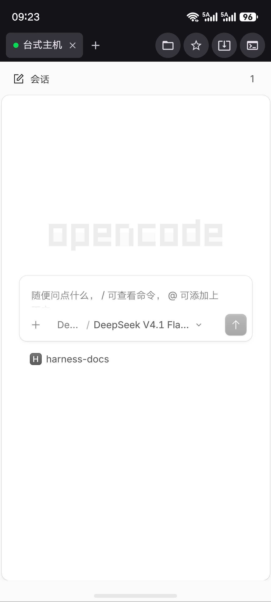
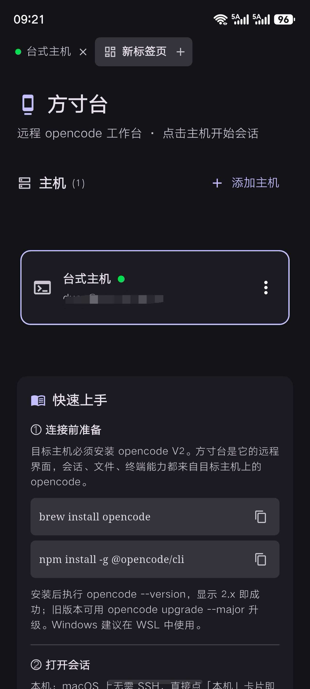
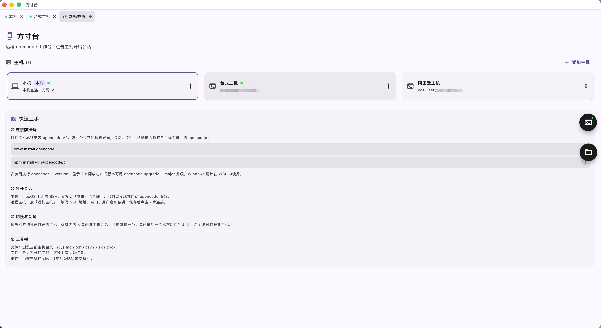
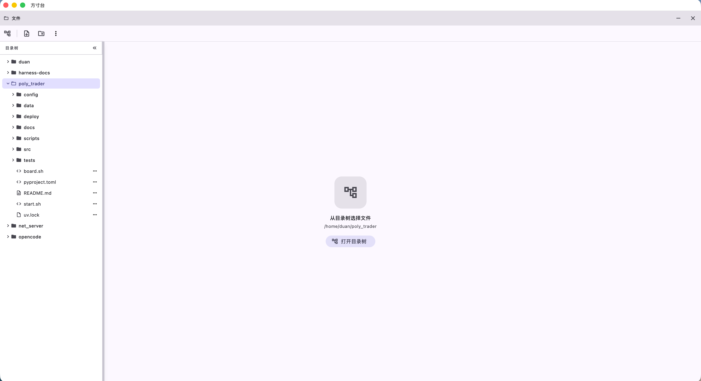

# 方寸台 TinyDesk

**让你的 [opencode](https://opencode.ai/) 在手机和电脑上随处可用。**

[opencode](https://opencode.ai/) 是一款终端 AI 编码代理，跑在你的电脑或服务器上。它一跑起来就离不开那台机器：AI 的任务常常要执行几分钟甚至更久，但你没法一直守在屏幕前——起身倒杯水、通勤路上、躺在床上想看一眼它改了什么、批准一个权限请求，都做不到；换个设备想接着用，又是重新配置一遍。

TinyDesk 就是为这个而生：App 自动建立 SSH 隧道并打开 opencode 的完整界面，同时补上终端、文件浏览与跨设备的收藏和阅读进度——它把 opencode 变成一个随身工作台。

<p align="center">
  
  &nbsp;&nbsp;
  
</p>

机器侧无需任何改造——复用你已有的 `sshd` 和 opencode，不开放公网端口、不安装 Agent。

## 功能

- **多主机会话**：同时保持多条 SSH 连接，用标签栏切换；退出后重新打开会恢复上次的会话。
- **内嵌 opencode Web UI**：通过本地端口转发访问服务器上的 `opencode serve`，不开放公网端口。
- **本机主机**（macOS）：直接使用本机已安装的 opencode，无需 SSH，也无需配置主机。
- **终端**：远程主机走 SSH shell；本机使用系统登录 shell（`$SHELL -l`）。支持多会话并行，窗口尺寸变化会同步到 PTY。
- **悬浮文件浏览器**：悬浮球 + 全屏窗口，随时唤出、最小化保留状态；多工程根并列、目录树懒加载、新建/删除、收藏。
- **文档查看与编辑**：Markdown（阅读 / 编辑双模式，文档引用的本机图片自动加载显示）、代码与文本（CodeMirror 6）、PDF、Word、Excel/CSV、图片。
- **二维码跨设备同步**：把主机（含私钥）编码为**两张先后出示的二维码**——一张随机密钥码、一张加密内容码。两码分屏出示、不同时可见，单张截图无法还原；内容 15 分钟内有效。目标设备扫码即导入（macOS/iOS/Android 用相机，鸿蒙用系统扫码，桌面端也可粘贴）。
- **收藏与阅读进度**：收藏按主机分组；收藏与 Markdown/PDF 的阅读位置写入项目的 `.tinydesk/users/<SSH 用户名>/`，同一用户在多台设备间共享，不同服务器账号互相隔离。
- **自动同步**：打开的文档与展开的目录每 5 秒检测服务器端变化并自动更新（有未保存编辑时绝不覆盖，只提示冲突）。
- **opencode 升级**：在主机上读取当前与最新版本，一键升级并重启服务。
- **安全**：私钥与口令保存在系统安全存储；主机指纹首次确认，变更时阻断连接。
- **设置**（主机列表右上角）：深色模式、字体缩放、后台保活、进入会话自动收起键盘、清除本机数据。

## 平台支持

| 平台 | 状态 | 说明 |
|---|---|---|
| macOS | ✅ | 完整功能，含本机主机与本地终端 |
| iOS | ✅ | 完整功能；无本机主机 |
| Android | ✅ | 完整功能；无本机主机 |
| HarmonyOS NEXT | ✅ | 完整功能；无本机主机 |
| Linux / Windows | 🚧 计划中 | 依赖桌面 WebView 方案，尚未实现，可自行使用 AI 实现 |

## 工作原理

```
┌─────────────────────────── 设备 ───────────────────────────┐
│  Flutter UI                                                │
│    ├─ 主机列表 / 会话标签                                   │
│    ├─ WebView（opencode Web UI）                            │
│    ├─ 悬浮终端（SSH shell / 本地 PTY）                       │
│    └─ 悬浮文件浏览器（SFTP / 本地文件）                       │
│                                                            │
│  dartssh2 ── 本地端口转发 127.0.0.1:<local> ──┐              │
└───────────────────────────────────────────────┼─────────────┘
                                                │ SSH :22
┌───────────────────────────────────────────────▼─────────────┐
│  服务器                                                     │
│    sshd                                                     │
│    opencode serve 127.0.0.1:49374                           │
└─────────────────────────────────────────────────────────────┘
```

- 每条主机连接都会在设备本地分配一个空闲端口，转发到服务器上的 opencode 服务。
- 文件与终端复用同一条 SSH 连接（SFTP + shell 通道）。
- 桌面端的「本机」主机直接在本地启动/连接 opencode，通过本地回环地址访问，不建立 SSH。

## 主机准备

服务器只需要已有的 `sshd` 和 opencode v2，不安装 Agent，也不开放公网端口。

```bash
# 确认 opencode 版本（需要 v2）
opencode --version

# 服务默认监听 127.0.0.1:49374；
# 如果你改过配置，用下面两条恢复回环监听与默认端口
opencode service set hostname 127.0.0.1
opencode service set port 49374

opencode service start
opencode service status   # 应输出 http://127.0.0.1:49374
```

App 侧需要：

- 能用 OpenSSH 格式的私钥通过 SSH 登录该主机（支持带 passphrase 的密钥；不支持 PuTTY `.ppk`，暂不支持密码登录）
- 首次连接时确认主机指纹
- 远端端口默认 `49374`，本地端口自动分配，可在主机表单中修改

## 安装与构建

需要 Flutter 3.47 或更新的稳定版。

```bash
git clone <repo-url> tinydesk
cd tinydesk
flutter pub get
```

### macOS

```bash
flutter build macos --release
open build/macos/Build/Products/Release/TinyDesk.app
```

依赖通过 CocoaPods 管理，建议使用 1.17 或更新版本（旧版本无法解析当前的 SPM 配置）。

### iOS

```bash
flutter build ios --release
```

工程没有锁定开发团队，首次构建请在 Xcode 中选择你自己的 Team。

### Android

```bash
flutter build apk --release
```

未配置 release keystore 时会使用调试签名；上架前请配置自己的签名。

### HarmonyOS NEXT

前置条件：安装 DevEco Studio（含 HarmonyOS SDK 与 `ohpm`/`hdc` 工具链，首次启动登录华为开发者账号），并安装 Flutter-OH（[openharmony-sig/flutter_flutter](https://gitcode.com/openharmony-sig/flutter_flutter)，见 `scripts/env-ohos.sh` 中的说明）；手机需开启开发者模式与 USB 调试。

```bash
# 1. 准备签名配置（只需一次）
cp ohos/build-profile.example.json5 ohos/build-profile.json5
# 用 DevEco Studio 打开 ohos/，在 Project Structure → Signing Configs 中生成自动签名

# 2. 构建
source scripts/env-ohos.sh
export JAVA_TOOL_OPTIONS="-Djdk.util.zip.disableZip64ExtraFieldValidation=true"
flutter build hap --release

# 3. 安装
hdc install -r build/ohos/hap/entry-default-signed.hap
```

常见问题：SDK 未识别用 `flutter config --ohos-sdk <sdk 路径>`；`ohpm`/`hdc` 不在 PATH 时把 DevEco Studio 的 `Contents/tools/ohpm/bin` 与 `Contents/sdk/default/openharmony/toolchains` 加进 PATH；手机连不上时确认 USB 调试并尝试 `hdc kill` 后重试。其余参考华为开发者文档与 Flutter-OHOS 社区文档。

## 使用

1. **添加主机**：主机列表 → 添加，填写地址、端口、用户名，粘贴 OpenSSH 私钥（可选 passphrase）。
2. **连接**：点击主机，等待隧道与服务探活完成，进入工作区。

   <p align="center">
     
     &nbsp;&nbsp;&nbsp;
     
   </p>
3. **工作区工具栏**：文件、收藏、opencode 升级、终端。
4. **文件浏览器**：悬浮球可拖动；点击展开，最小化后状态保留；「更多 → 刷新」会重新读取服务器上的文件。

   <p align="center">
     
     &nbsp;&nbsp;&nbsp;
     
   </p>
5. **本机主机**（macOS）：自动创建，点击即用；终端运行系统登录 shell。
6. **设置**：主机列表右上角；「清除数据」会删除本机的主机、密钥、会话、收藏与阅读状态，但保留主题等设备偏好。
7. **跨设备同步主机**：在已有主机的设备上点主机菜单「显示主机二维码」，在新设备上「添加主机 → 扫码添加」，先后扫描两张二维码即可把主机（含私钥）迁移过去；桌面端也可以通过复制/粘贴完成。

   <p align="center">
     
     &nbsp;&nbsp;&nbsp;
     
   </p>

## 数据存放在哪里

| 数据 | 位置 |
|---|---|
| 主机列表、会话状态、设置 | 本机（应用私有存储） |
| 私钥与 passphrase | 系统安全存储（Keychain / Keystore / Asset Store） |
| 收藏、阅读进度 | 项目的 `.tinydesk/users/<SSH 用户名>/`（服务器上）；同一用户跨设备共享，不同账号互相隔离 |
| opencode 会话 cookie | 系统 WebView 的 cookie 存储 |

## 安全模型

- SSH 直连主机，不经过任何中转服务器；没有遥测，也没有云端同步。
- 主机指纹首次确认后记录，变更时阻断连接并要求确认。
- 私钥与口令保存在系统安全存储：macOS/iOS 使用 Keychain，Android 使用 Keystore 加密的存储，HarmonyOS 使用 Asset Store。
- 旧版本留在 SharedPreferences 中的明文私钥会在启动时自动迁移，成功后删除明文。
- 私钥、口令与会话 cookie 不写入日志或临时文件。

## 开发

```bash
flutter test      # 单元 + Widget 测试
flutter analyze   # 静态检查
```

端到端连接检查（不需要 App）：

```bash
OC_TEST_HOST=your-host.example.com \
OC_TEST_PORT=22 \
OC_TEST_USER=user \
OC_TEST_KEY=$HOME/.ssh/id_ed25519 \
dart run tool/integration_check.dart
```

### 目录结构

```
lib/
├─ core/            会话管理、连接状态机
├─ data/            主机仓库、安全存储、本地会话、收藏与同步
├─ ssh/             SSH 连接、端口转发、隧道会话
├─ opencode/        服务探活、配对、opencode CLI 解析
├─ features/
│  ├─ hosts/        主机列表与表单
│  ├─ connect/      连接进度
│  ├─ workspace/    WebView 工作区与会话标签
│  ├─ terminal/     悬浮终端
│  ├─ documents/    悬浮文件浏览器与各类文档视图
│  └─ settings/     设置
└─ platform/        平台通道（文件选择、窗口、输入拦截等）
third_party/        webview_flutter 鸿蒙适配、xterm fork
docs/               设计文档与构建说明
tool/               开发辅助脚本
```

## 已知限制

- 不支持 Linux / Windows 桌面（有计划）。
- 移动端没有「本机」主机（系统层面没有可用的 opencode CLI）。
- 不支持密码登录与 PuTTY `.ppk` 私钥。
- 同一主机上的多个文件浏览器窗口共用一棵目录树根。
- 私钥完成安全迁移后，回退到旧版本会读不到私钥。
- iOS / macOS 的 Keychain 数据在卸载重装后可能保留，需要在系统里手动清除。

## 许可证

[MIT](LICENSE)

## 第三方组件

- [Flutter](https://flutter.dev/)（BSD-3-Clause）
- [dartssh2](https://pub.dev/packages/dartssh2)（MIT）
- [xterm.dart](https://pub.dev/packages/xterm)（MIT，仓库内为修改版）
- [flutter_pty](https://pub.dev/packages/flutter_pty)（MIT）
- [flutter_secure_storage](https://pub.dev/packages/flutter_secure_storage)（BSD-3-Clause）
- [webview_flutter](https://pub.dev/packages/webview_flutter) 与 HarmonyOS 适配（BSD-3-Clause，仓库内为修改版）
- [PDF.js](https://mozilla.github.io/pdf.js/)（Apache-2.0）
- [CodeMirror 6](https://codemirror.net/)（MIT）
- [SheetJS](https://sheetjs.com/)（Apache-2.0）
- [mammoth.js](https://github.com/mwilliamson/mammoth.js)（BSD-2-Clause）
- [Meslo LG](https://github.com/andreberg/Meslo-Font)（Apache-2.0）
